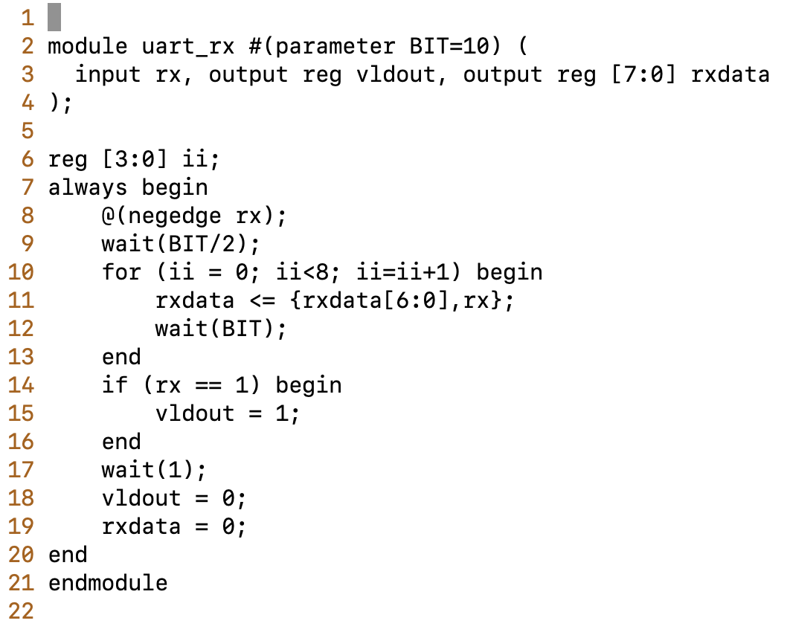
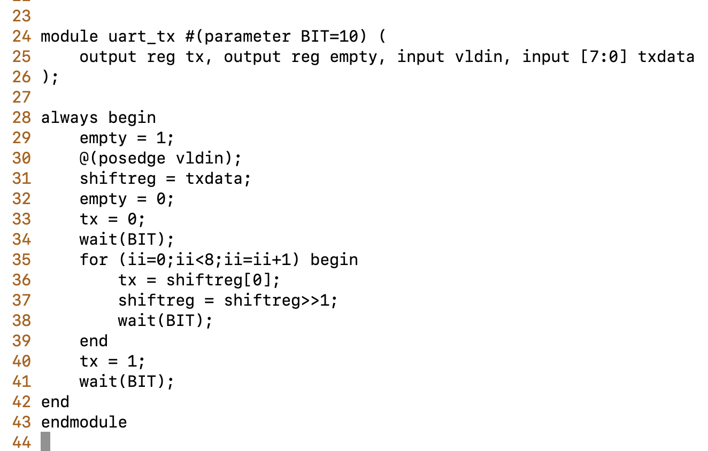
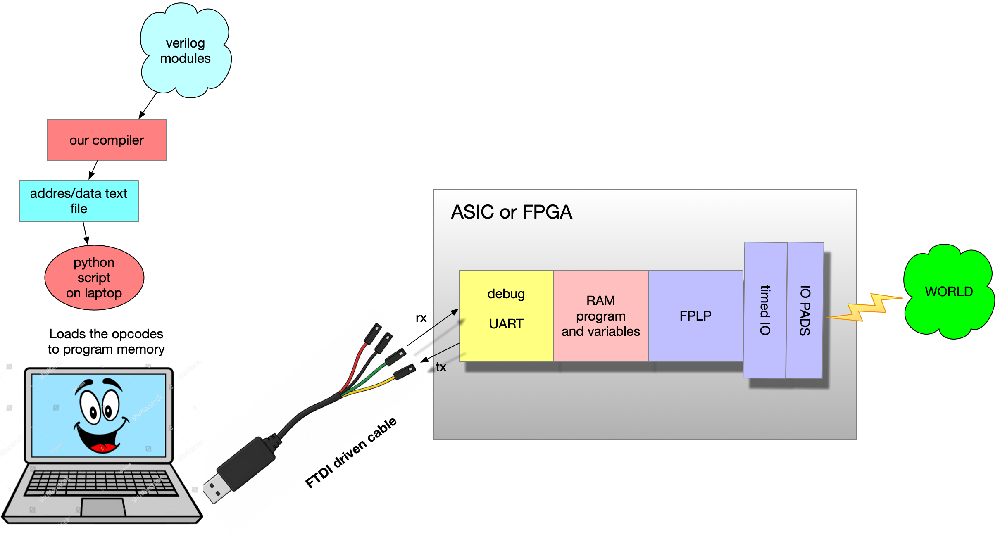

<!---

This file is used to generate your project datasheet. Please fill in the information below and delete any unused
sections.

You can also include images in this folder and reference them in the markdown. Each image must be less than
512 kb in size, and the combined size of all images must be less than 1 MB.
-->

## How it works

# Field Programmable Logic Processor
This challenge appeared on my LinkedIn feed. It came from Jane Street company.  Reading the goal, it reminded me of a project we were toying with years ago - FPLP.   it seems like a good fit to implement the goal.

.

## 1. The Challenge (as copied from Jane Street site)
###     Goal: Design an open-source, general-purpose protocol emulator ASIC.

--------------------------------------------
## 2. How we attack this challenge

### 2.1 Overview of our old idea, and why it can be more effective than FPGA
We started from IOT ASIC project. Internet of things. It encompasses a wide range of potential projects and devices.
First candidate could be an FPGA that could serve as a platform upon which multitude of applications can be realized.

Many IOT applications deal with physical world. In this domain the speed of events is not getting faster.
Motor control as example is limited in speed , same as audio and low def video. Driving displays, communicating over slow channels,
sampling sensors - all these examples are not getting faster over time because of physics.  also LIN and slow CAN  when serving opening doors and windows in vehicles.

Another important aspect of these applications is their complexity. Big amount of logic  is needed to implement something like CAN protocols.
So there is complex logic coupled with modest speed/performance requirements.

On the other hand FPGA transistors are getting more numerous (and expensive to implement), power hungry and faster.
In the end , giga hertz fpga transistor of finFet technology implements humble UART or timer or something similarly slow.

The point here is that interfacing to physical devices can be handled by different approach.
FPGA implements logic by assigning each transistor (inside LUT) to a specific function. Our approach calls for sharing these fast transistors among many different functions.

One  way to explain our implemention approach  - is by analogy to Hardware Verilog Simulator of TestBench code.
Assume we implement verilog simulator on a chip. Customer writes a  Verilog code that implements
the desired functionality. The code  is compiled (by special compiler for our special processor)  into a program RAM.
The "simulation processor" executes the functionality by fetching it from the RAM.
The processor keeps the exact delays as written in the verilog code.  The processor is timing aware. It is activated by ready-to-run threads. Think of a thread as "assign" or "always" statement in verilog.
The user's verilog code is unlike RTL, but rather "testbench" variety.

Idea is to debug the code in regular simulator, and then upload it to the "real" hardware.

We call the processor Field Programmable Logic Processor. It includes mechanisms for keeping the precise timing declared in verilog code.

### 2.2 Example of UART design in testbench verilog.

To show general idea of "TestBench verilog". This is receive part of UART. It is not RTL, dont try to synthesize it, but under certain constraints it will simulate  real UART. All timing is in system clock.

This TX part

What is left, is to show that other standards can be realized by this architecture. 🤦

### 2.3 System view

Conceptual diagram of system setup

### 2.4  FPLP Design

Some parts of the design are pretty good clear. Some more fuzzy.   Some effort is needed to put the Block Diagram here.

### 2.4.1 Special time aware IO

The IO bits,  can generate event on input change, sample the input at requested clock cycle,  drive output to a new value at requested clock cycle. And be able to bunch several IO's to behave like a bus (same control on subset of IOs)

### 2.4.2 Threads timing wheel

Threads become ready to run when related trigger (either internal or external) happens. Scheduler module activates highest priority thread on next available processor.

### 2.4.3 Triggers driven, Thread running CPU

Processor waken up by trigger starts runniing the related thread. Threads are short and once finished, CPU is ready to accept next job.

### 2.4.4 Data Addressing : bit, 2bit, 4bit, 8bits variables

left empty on purpose

### 2.4.5 Program Addressing  and Width

TBD

## 3. Minimal Hardware : severe hardware constraints

With the  given process, achieving 100 mhz should not be very hard.  The challenge is to fit usable amount of logic into the allocated space. Building a reasonable RAM from flops or latches is also not trivial.

The original architecture calls for several processors working in parallel on all threads (like wondering threads) . This will cover more tight timed protocols, However to implement CAN for example, will require more program and data rams and possibly a host processor. Here we cannot accomodate another CPU (like RiscV), so to prove the concept, we will communicate through the UART (real one) interface to laptop running support software.

## How to test

1. communicate with the debugUart using UART, The protocol is defined in additional document.
2. fill the program ram.
3. fill the doorbells registers.
4. enable the run.
5. See the pins toggle happily.

Full protocol defined in accompanying document.

## External hardware

The host connects to the project by UART. The default BaudRate is 1Mhz. can be changed later.
Optional are 4 LEDS. Have no predefined job. Can be used by application.
Optional are 3 (On/Off) Switches. Have no defined job. Can be used by application.
